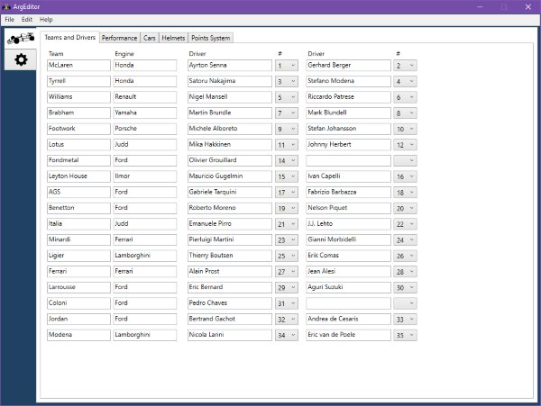
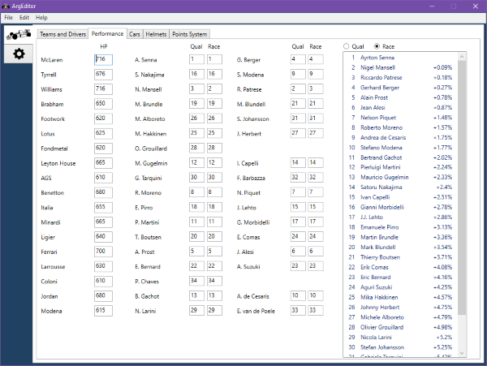
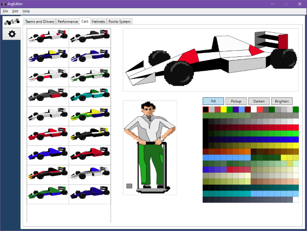
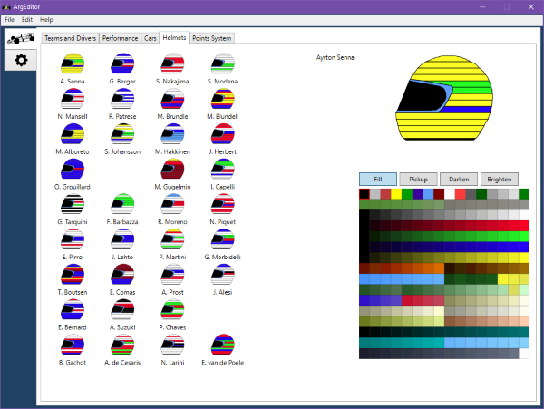
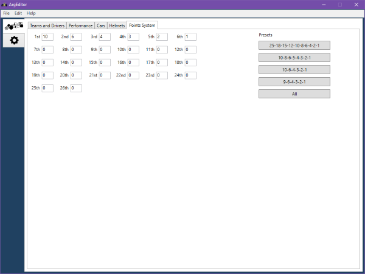

# Car Sets

The Car Sets screen has a number of tabs at the top of the screen, with
something of a natural order to them. In the first,
you enter the teams and drivers, on the second tab you set their performance,
on the third you paint the cars and pit crews. On the fourth
tab you paint the drivers' helmets, and on the final tab you edit the points system.

## Teams and drivers

This is where you enter team names and their engines, one or two drivers for
each team. You must also set a number for the driver, where the numbers available
range from 1 to 40.

A team can be disabled by emptying its name and engine. A driver can be disabled
by emptying their name.

There must be at least 26 active drivers. Two drivers cannot have the same numbers.

A driver's name can be 23 characters long, but may appear cut off in-game if it
is longer than 18 characters, depending on the width of the characters.
Team and engine names can be 12 characters long.

Note that the first team in the list has a different car shape than the other
teams. This is because the first team in 1991 was McLaren,
which had the well-known Marlboro paint scheme
with a red diagonal stripe across the nose cone. So if you are making a car set
that does not feature a classic McLaren paint scheme, it would be advisable to
leave the first team empty, and also skip the second team for nicer symmetry
on the F1GP driver selection screen.

## Performance

Horsepower values determine how fast the cars will be, where higher is better.

Drivers have two performance levels, one for qualifying and one for the race. A lower
value means better performance level, so think of the value you are setting as
a "penalty".

On the right you will see a rough estimate of how drivers will perform relative
to each other. These values are based on data collected for drivers at the
Silverstone track, which was chosen because of its mix of straights and different
corners. At high speed tracks like Hockenheim and Monza, the horsepower value
will have a much greater effect on the lap times. At the opposite end of the
spectrum, lap times at Monaco will be much more influenced by the performance level
of the drivers.

### Suitable values

In F1GP, teams have horsepower values ranging from 716 at the top to 610 at the
bottom. Drivers have their perforamnce levels in order, from 1 at the top to 34 at
the bottom.

Performance levels can be set as high as 255, but then the driver will just
trundle along the track, sliding like a drift racer. I would not recommend
going above 50.

### Performance levels and qualifying sessions

A thing to note is that when you completely skip the qualifying session in
F1GP, the grid that the game sets up for you is _only_ based on the horsepower
value of the car, and not at all by the driver performance level. Therefore, skipping the
qualifying session will remove any performance differences you have set between
team-mates.

## Cars

This is where you paint cars and pit crews.

Click on a car in the left part of the screen to paint it. Painting is done by
using the [palette tools](palette-tools.md), which allow you to paint panels,
select the color of an existing panel, and darken or brighten a panel.

The same applies for painting the pit crew.

As noted above in the Teams and Drivers section, the first car - McLaren in
the default game - has a slightly different panel layout on the nose.

You can undo a painting action with Ctrl+Z and redo actions with Ctrl+Y.

By right-clicking on a car, a context menu appears. It has three actions:

* Copy, which copies the selected car to the clipboard
* Paste, which pastes a car from the clipboard to the selected position
* Load .CAR File, which allows you to load a .CAR file from disk to update the selected car

## Helmets

Here is where you paint driver helmets.

The selection and painting works in the same way as in the Cars tab, see the
[palette tools](palette-tools.md) page for more information.

By right-clicking on a helmet, a context menu appears. It has three actions:

* Copy, which copies the selected helmet to the clipboard
* Paste, which pastes a helmet from the clipboard to the selected position
* Load .HEL File, which allows you to load a .HEL file from disk to update the selected helmet

### Helmets behaving differently

Presumably for optimization reasons, some helmets in the game have fewer colors
available to them. Helmets for drivers with #13, #15, #36, #37, #38, #39 and #40
will always have the same color for the bottom two-thirds of their helmets.
The only driver this affects among the default drivers is #15 Mauricio Gugelmin,
who has a helmet that is mostly dark red anyway.

However, if you use a [decompressed EXE](decompressed-exe.md) these limitations go away.

When editing one of these helmets, a message will be displayed, reminding you that it
will not export in the way you have painted it unless you are using a decompressed EXE file.

## Points System

This is where you set the number of points each finishing position scores for
the championship.

You can edit the number of points scored for each finishing position, from 1st down
to 26th. However, to award points to finishers in position 7th to 26th you need to
use a [decompressed EXE](decompressed-exe.md).

The maximum number of points that a finish can score is 255. Another thing to note
is that drivers that do not finish the races do not receive any points at all.

On the right is a number of buttons with presets for the F1 points scoring systems
used since the beginning of the 1960s. Click on a button to update the screen
with the specified system's points.

If you award points to positions 7th to 26th, a message will appear that informs
you that they will only be available if using a decompressed EXE file.
