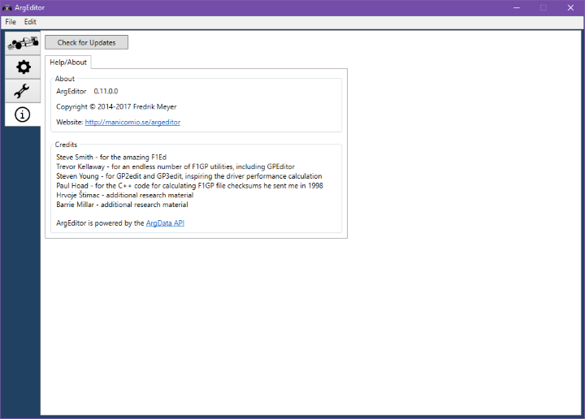

# Help/About Screen

The Help/About screen lets you see which version you are currently
running and check if there are any available updates.

At the top, you have the Check for Updates button. Clicking it will
ask ArgEditor's webserver if there is a newer version available.
If there is, a link to the download page will be displayed.

You can also see the current version number, and a link to ArgEditor's
website.

Finally, some credits appear.
