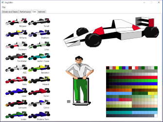

# ArgEditor - an editor for F1GP

In early 1992, Geoff Crammond and Microprose released Formula One Grand Prix.
The rest, as they say, is history.

## Features

* Update the names of teams and drivers
* Set computer car horsepower levels and driver grip levels
* Paint cars, pit crew clothing and helmets

## System requirements

* Windows Vista SP2, 7 SP1, 8, 8.1 or 10
* Microsoft .NET Framework 4.5.2
* F1GP (European) or World Circuit (US) version 1.05

Copyright &copy; 2015 Fredrik Meyer
