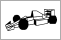
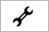

# Introduction

When starting ArgEditor, you will notice that there are four horizontal tabs on the left.

Click on the link in the table below for the screen you want to learn more about.

|                                                  |                                                                         |
|--------------------------------------------------|-------------------------------------------------------------------------|
|           |  [Car Set screen](carset-screen) for creating year-based car sets             |
|   |  [Game Settings screen](settings-screen) for changing various game settings   |
|      |  [Car Setup Screen](setups-screen) for creating and editing car setups  |
|    |  [Help/About Screen](help-about-screen) for version information, checking for updates, credits, etc |
| [Menus](menus.md)            | Describes the menus at the top of the application |

