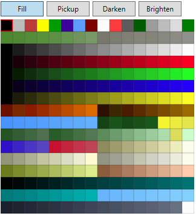

# Palette Tools

The palette tool consists of four buttons, which indicate its current mode, and a palette of
256 colors.

### Fill

The default mode, where clicking on a paintable panel will fill it with the selected color in the palette.

### Pickup

When this mode is active, clicking on a panel will select its color in the palette. For instance, if you
have a color on the car that you want to paint another panel with, you would select the *Pickup* tool,
click the panel, then switch over to *Fill* mode and click the panel that you want to paint.

### Darken

With this mode active, clicking on a panel will paint it with the next darker color available in the palette.
If there is no darker color, nothing will happen.

### Brighten

With this mode active, clicking on a panel will paint it with the next brighter color available in the palette.
If there is no brighter color, nothing will happen.
