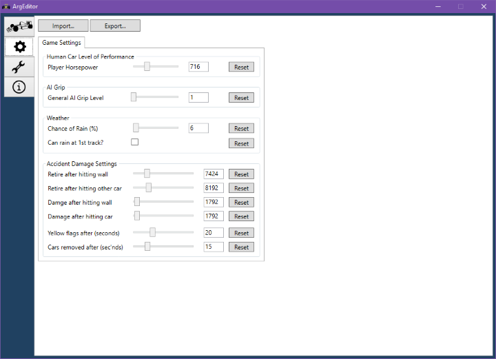

## Settings Tab

By clicking on the cogwheel on the left, you get to the game settings screen.

There are a number things you can edit here.

The player horsepower value represents how powerful _your_ engine is in the game.
The default value is 716, just like the top teams.

You can also adjust the general AI grip level. The default value is 1, but
by increasing the value you can give yourself more of a challenge. The maximum
value that can be set is 100.

Another thing yo edit is the likelihood of a wet weather race occuring (the default
change is 6%) and whether there is a chance of rain at the first track (i.e. Phoenix).
By default, wet weather races don't occur in Phoenix, because a 100% race almost
always takes two hours anyway.

The final items that can change or the accident damage settings. These determine
how likely it is that your car retires or receives wing damage when colliding
with walls or other cars. A lower value means that it is _more_ likely that damage occurs.

You can also change the number of seconds before marshalls show yellow flags for
stationary cars, and the number of seconds before retired cars are removed from the track.

Note that game settings are _not_ saved in ArgEditor car set files,
but they _are_ saved in F1Ed files.

You can use the Import and Export buttons at the top to quickly import or export
only the settings on this screen to or from an EXE file.
