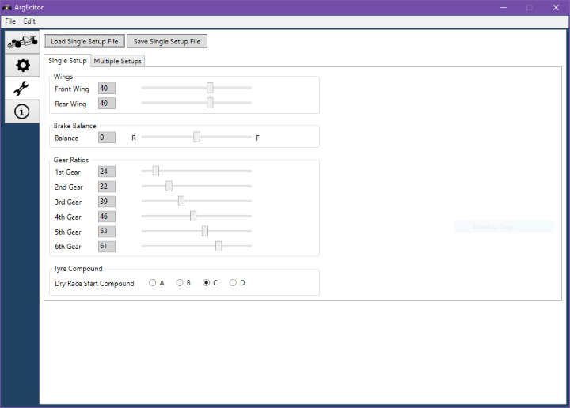
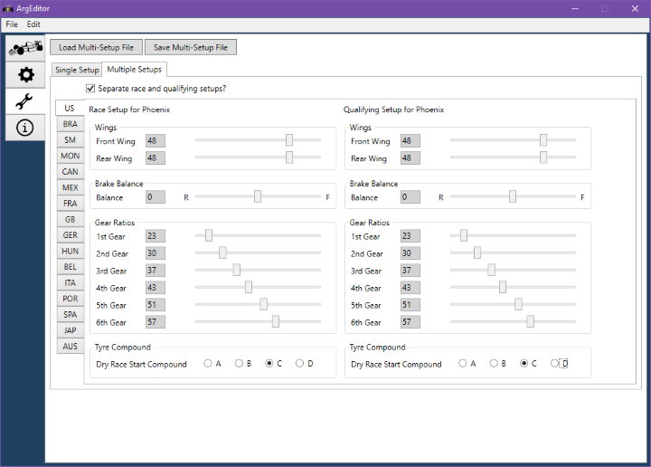

# Setups Screen

The Setups screen allows you to create and edit single and multiple setup files for
use inside F1GP.

## Single Setup Tab

This is where you work with single setups.

For a setup, you can change the front and rear wings, the brake balance,
the gear ratios and finally the tyre compound that will be used in dry races.

If you select incorrect gear ratios, there will be an indication to the right
of the sliders, and you will not be able to save the setup.

The toolbar buttons at the top allow you to load an existing setup, or save the
current one you are editing to disk.

## Multi Setup Tab

This is where you work with multiple-setup files, which contain setups for each of
the 16 tracks in the game.

The "Separate race and qualifying setups?" checkbox determines if you edit one
or two setups per track. If you do not check this box, you will use the same setup
both for qualifying and races.

To change which track you are editing the setup for, select it using the small
tabs arranged vertically on the left, which have the country abbreviations on them.

For each setup, you can change the front and rear wings, the brake balance,
the gear ratios and finally the tyre compound that will be used in dry races.

If you select incorrect gear ratios, there will be an indication to the right
of the sliders, and you will not be able to save the setups.

The toolbar buttons at the top allow you to load existing setups, or save the
current ones you are editing to disk.
